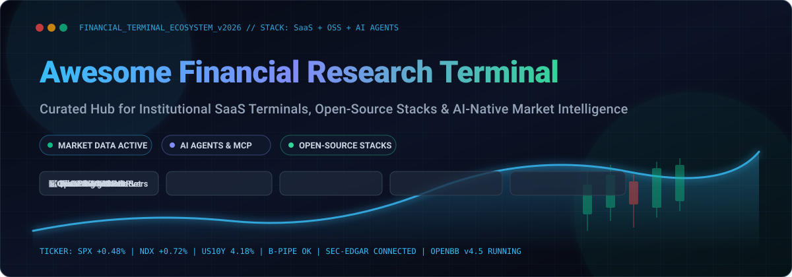

<div align="center">



# 📈 Awesome Financial Research Terminal 🚀

### *The Curated Landscape of Institutional SaaS Terminals, Open-Source Market Data Engines & AI-Native Analyst Workflows*

[](https://awesome.re)
[](https://github.com/ishandutta2007/Awesome-Financial-Research-Terminal/stargazers)
[](LICENSE)
[](CONTRIBUTING.md)
[](https://www.python.org/)
[](#)

<!-- keywords: financial terminal, bloomberg terminal alternative, openbb, market data, factset, capital iq, lseg workspace, algorithmic trading, quantitative finance, ai agents, sec edgar, xbrl, mcp server, backtesting, equity research -->

<p align="center">
  <b>A comprehensive directory cataloging both multi-billion-dollar enterprise platforms and transparent open-source stacks. Built for quantitative researchers, hedge funds, independent analysts, fintech engineers, and AI agents.</b>
</p>

[🌐 SaaS Platforms](#-saas-hosted-platforms) • [⚡ Open-Source Projects](#-open-source-github-projects) • [📊 Sector Dynamics](#-sector-overview--market-dynamics) • [🛠️ Terminal Stacks](#-recommended-diy-open-stack-architectures) • [🤝 Contributing](#-how-to-contribute)

---

</div>

## 📑 Table of Contents

- [🏛️ Sector Overview & Market Dynamics](#-sector-overview--market-dynamics)
- [💼 SaaS & Hosted Institutional Platforms](#-saas-hosted-platforms)
- [🔓 Open-Source GitHub Projects](#-open-source-github-projects)
- [🛠️ Recommended DIY Open-Stack Architectures](#-recommended-diy-open-stack-architectures)
- [🚀 Quickstart: Open Research Terminal in 60 Seconds](#-quickstart-open-research-terminal-in-60-seconds)
- [🤝 How to Contribute](#-how-to-contribute)
- [⚖️ Disclaimer](#️-disclaimer)

---

## 🏛️ Sector Overview & Market Dynamics

The global financial market data, terminal, and investment analytics sector represents an estimated **$49 billion to $50 billion annual market**, compounding at **6%–8% CAGR** amid soaring demand for low-latency market intelligence, alternative datasets, and programmatic AI ingestion.

The sector is **highly concentrated and oligopolistic**—a quintessential *winner-take-all* market where two titans, **Bloomberg L.P. (~33% market share)** and **LSEG Workspace (~19% market share)**, capture over half of total global industry spend. Institutional moats are anchored in proprietary peer networks (Bloomberg IB Chat), mission-critical exchange connectivity, deep broker research syndication, and steep user switching costs. However, the mid-market and independent research tiers are rapidly unbundling: **open-source frameworks (OpenBB, Qlib)** and **AI Model Context Protocol (MCP) servers** now empower small funds, quant developers, and autonomous agents to replicate institutional-grade analytics without $30,000+ per-seat tollgates.

---

## 💼 SaaS / Hosted Platforms

Institutional and mid-market SaaS platforms ranked in descending order by **Company Scale (Market Capitalization or Enterprise Valuation)**.

> 💡 *Note: Institutional platforms often operate on quote-based custom agreements. The figures below reflect verified base and starting-tier annual licenses for single seats.*

| 🏢 Platform | 🌐 Official Link | 💰 Company Scale (Revenue / Valuation) 🔻 | 🏷️ Specific Starting Pricing | ⏱️ Specific Free Tier / Free Trial Limits | 🎯 Core Specialization & Key Features |
| :--- | :--- | :--- | :--- | :--- | :--- |
| **S&P Capital IQ** | [capitaliq.com](https://www.capitaliq.com/) | **~$155.0 Billion Market Cap**<br>*(NYSE: SPGI · ~$13.5B ARR)* | **$12,000 / user / year**<br>*(~$1,000/mo billed annually; loaded seats $20K–$30K/yr)* | **No perpetual free tier**.<br>Offers a **7-day free trial** for verified institutional business emails via sales rep (capped at 50 company searches and basic Excel export limits). | 🏛️ Private equity, credit ratings, global M&A deal intelligence, deep corporate balance sheets, and standard financial modeling. |
| **Bloomberg Terminal** | [bloomberg.com](https://www.bloomberg.com/professional/) | **~$120.0 Billion Valuation**<br>*(Private · ~$13.3B ARR)* | **$31,980 / year**<br>*(~$2,665/mo single seat; $28,320/yr per seat for 2+ licenses)* | **No perpetual free tier**.<br>Offers a **30-day proof-of-concept (PoC) pilot** exclusively for qualified enterprise/institutional sales prospects via dedicated account executive. | ⚡ Real-time multi-asset quotes, fixed income/bonds analytics, order execution, breaking terminal news, and IB Chat institutional communication lock-in. |
| **LSEG Workspace** *(Refinitiv Eikon)* | [lseg.com](https://www.lseg.com/en/data-analytics/products/workspace) | **~$70.0 Billion Market Cap**<br>*(LSE: LSEG · ~$10.5B ARR)* | **$3,600 / year**<br>*(~$300/mo for narrow wealth tier; institutional seats ~$22,000/yr)* | **No perpetual free tier**.<br>Offers a **30-day institutional evaluation trial** upon corporate domain registration and identity validation. | 💱 Foreign exchange (FX) infrastructure, Reuters news syndication, global macro time-series (Datastream), and cross-asset execution. |
| **FactSet** | [factset.com](https://www.factset.com/) | **~$17.0 Billion Market Cap**<br>*(NYSE: FDS · ~$2.2B ARR)* | **$4,000 / year**<br>*(~$333.33/mo light workstation; core analyst seats $9K–$14K/yr; quant $50K)* | **No perpetual free tier**.<br>Offers a **7-day free trial** for accredited investment professionals with core equity research and basic workstation screening. | 📊 Buy-side & sell-side equity research, detailed consensus earnings estimates, portfolio risk attribution, and seamless Excel links. |
| **Morningstar Direct** | [morningstar.com](https://www.morningstar.com/products/direct) | **~$13.5 Billion Market Cap**<br>*(NASDAQ: MORN · ~$2.1B ARR)* | **$18,500 / year**<br>*(~$1,541.67/mo 1st seat; $11,500/yr per extra seat; retail Investor at $249/yr)* | **Perpetual free tier available** on Morningstar.com (basic delayed quotes, 5-stock watchlist, non-premium articles). Direct workstation offers a **14-day institutional trial** on request. | 📈 Mutual fund and ETF ratings, manager due diligence, ESG metrics, asset allocation modeling, and wealth management reporting. |
| **PitchBook** *(Morningstar)* | [pitchbook.com](https://pitchbook.com/) | **~$13.5 Billion Parent Scale**<br>*(Morningstar Subsidiary · ~$500M+ ARR)* | **$20,000 / year**<br>*(~$1,666.67/mo single-seat base package; ~$5,000/yr per additional user)* | **No perpetual free tier**.<br>Offers a **7-day restricted preview trial** upon sales approval (capped at viewing 5 full company profiles and 10 fund searches). | 🦄 Venture capital, private equity fund tracking, LP/GP commitments, startup valuation multiples, and tech M&A intelligence. |
| **AlphaSense** | [alpha-sense.com](https://www.alpha-sense.com/) | **$4.0 Billion Valuation**<br>*(Private Series E · ~$250M–$300M ARR)* | **$10,000 / seat / year**<br>*(~$833.33/mo billed annually for corporate research plan)* | **No perpetual free tier**.<br>Offers a **14-day free trial** for verified corporate domains (includes 50 document searches and AI summaries across filings and broker notes). | 🤖 Generative AI semantic search, broker research ingestion, earnings call audio sentiment, and SEC disclosure monitoring. |
| **Tegus** *(AlphaSense)* | [tegus.com](https://www.tegus.com/) | **$930.0 Million Acquisition**<br>*(AlphaSense Subsidiary · ~$100M+ ARR)* | **$25,000 / year**<br>*(~$2,083.33/mo platform subscription with monthly expert call allowances)* | **No perpetual free tier**.<br>Offers a **7-day preview trial** upon institutional clearance (strictly restricted to reading 5 full expert call interview transcripts). | 🎙️ Qualitative primary research, 100,000+ searchable expert interview transcripts, management due diligence, and industry specialist calls. |
| **YCharts** | [ycharts.com](https://ycharts.com/) | **~$150.0–$250.0 Million Valuation**<br>*(ParkerGale PE · ~$40M ARR)* | **$4,800 / year**<br>*(~$400/mo billed annually for Standard; Professional tier is $7,200/yr)* | **No perpetual free tier**.<br>Offers a **7-day free trial** with full access to 50+ visualization tools, stock screeners, and Excel add-in (limited to 100 export rows). | 📉 Visual financial charting, ETF comparison tear-sheets, portfolio visualizer, and client proposal generation for registered investment advisors (RIAs). |
| **Sentieo** *(AlphaSense)* | [sentieo.com](https://www.sentieo.com/) | **~$120.0 Million Acquisition**<br>*(AlphaSense Subsidiary)* | **$8,500 / seat / year**<br>*(~$708.33/mo for standalone research workspace)* | **No perpetual free tier**.<br>Offers a **14-day institutional free trial** via sales qualification covering SEC filing searches and financial table extractions. | 🔍 Financial document search engine, automated footnote and table extraction, collaborative research notebooks, and financial modeling. |
| **Koyfin** | [koyfin.com](https://www.koyfin.com/) | **~$50.0–$100.0 Million Valuation**<br>*(Private · ~$15M ARR)* | **$468 / year**<br>*(~$39/mo billed annually for Plus; Pro tier is $948/yr / $79/mo)* | **Free forever plan available** (2 watchlists up to 10 tickers each, delayed market data, 3 years historical financials, 2 dashboard views) + **7-day free trial** of Pro. | 💻 Modern browser terminal, macro market dashboards, valuation multi-charts, equity screening, and accessible institutional-style layouts. |

---

## 🔓 Open-Source GitHub Projects

Curated open-source terminal platforms, algorithmic frameworks, financial datasets, and AI research agents—**sorted descending by GitHub Star Count** ⭐.

| 🏆 Repository & Star Badge | ⭐ Stars | 💻 Language | 🏷️ Category | 📖 Description & Architectural Focus |
| :--- | :--- | :--- | :--- | :--- |
| **[OpenBB Platform](https://github.com/openbb-org/OpenBB)**<br>[](https://github.com/openbb-org/OpenBB/stargazers) | **74,000+** | Python | Financial Terminal & Data SDK | 🌟 The flagship open-source financial platform for analysts and AI agents. Standardizes 100+ data providers (Polygon, FMP, FRED, SEC) behind one Python interface. |
| **[Microsoft Qlib](https://github.com/microsoft/qlib)**<br>[](https://github.com/microsoft/qlib/stargazers) | **49,500+** | Python | AI Quantitative Investment | 🧠 AI-oriented quant investment platform by Microsoft. Covers Alpha discovery, machine-learning data preparation, strategy backtesting, and model evaluation. |
| **[VNPY](https://github.com/vnpy/vnpy)**<br>[](https://github.com/vnpy/vnpy/stargazers) | **45,900+** | Python / C++ | Quantitative Trading Framework | 📈 Institutional-grade quantitative trading framework supporting multi-asset order routing, algorithmic strategies, and high-frequency risk management. |
| **[CCXT](https://github.com/ccxt/ccxt)**<br>[](https://github.com/ccxt/ccxt/stargazers) | **44,500+** | TypeScript / Python | Market Data & Exchange API | 🪙 Unified crypto exchange & prediction market framework abstracting 100+ exchanges with normalized orderbooks, tickers, and websocket feeds. |
| **[yfinance](https://github.com/ranaroussi/yfinance)**<br>[](https://github.com/ranaroussi/yfinance/stargazers) | **25,500+** | Python | Market Data Scraper & API | 📊 Reliable and ubiquitous downloader for Yahoo! Finance historical price bars, real-time quotes, options chains, split histories, and balance sheet data. |
| **[Backtrader](https://github.com/mementum/backtrader)**<br>[](https://github.com/mementum/backtrader/stargazers) | **23,500+** | Python | Backtesting & Technicals | ⏱️ Feature-packed Python framework for backtesting trading systems, analyzing performance indicators, and executing paper trades. |
| **[AKShare](https://github.com/akfamily/akshare)**<br>[](https://github.com/akfamily/akshare/stargazers) | **23,000+** | Python | Global & APAC Financial Data | 🌏 Comprehensive financial data interface library fetching Chinese and global equities, futures, macroeconomic indicators, bonds, and currency rates. |
| **[QuantConnect Lean](https://github.com/QuantConnect/Lean)**<br>[](https://github.com/QuantConnect/Lean/stargazers) | **22,100+** | C# / Python | Algorithmic Trading Engine | 🏗️ Modular algorithmic trading engine powering institutional research across equities, options, futures, and forex with multi-broker support. |
| **[FinGPT](https://github.com/AI4Finance-Foundation/FinGPT)**<br>[](https://github.com/AI4Finance-Foundation/FinGPT/stargazers) | **21,400+** | Python | Financial LLMs & NLP | 🤖 Open-source financial large language models and fine-tuning pipelines specialized for financial sentiment, disclosure analysis, and credit assessment. |
| **[FinRL](https://github.com/AI4Finance-Foundation/FinRL)**<br>[](https://github.com/AI4Finance-Foundation/FinRL/stargazers) | **16,700+** | Python | Financial Reinforcement Learning | 🎮 Deep reinforcement learning framework for automated portfolio allocation, continuous action trading strategies, and paper simulation. |
| **[FinanceDatabase](https://github.com/JerBouma/FinanceDatabase)**<br>[](https://github.com/JerBouma/FinanceDatabase/stargazers) | **9,500+** | Python | Master Symbol Database | 🗃️ Curated registry of 300,000+ financial symbols categorized by sector, industry, country, and exchange covering equities, ETFs, funds, and indices. |
| **[edgartools](https://github.com/dgunning/edgartools)**<br>[](https://github.com/dgunning/edgartools/stargazers) | **2,800+** | Python | SEC EDGAR & XBRL Parser | 📑 High-speed, well-typed parser for U.S. SEC EDGAR filings (Forms 10-K, 10-Q, 8-K, 13F, Forms 3/4/5) with native XBRL financial statements extraction. |
| **[Financial Datasets MCP Server](https://github.com/financial-datasets/mcp-server)**<br>[](https://github.com/financial-datasets/mcp-server/stargazers) | **2,300+** | TypeScript / Python | Model Context Protocol (MCP) | 🔌 Model Context Protocol server exposing financial statements, balance sheets, income statements, and market tickers directly to LLMs like Claude and ChatGPT. |
| **[AI Financial Agent](https://github.com/virattt/ai-financial-agent)**<br>[](https://github.com/virattt/ai-financial-agent/stargazers) | **2,000+** | Python | Autonomous Research Agent | 🕵️ End-to-end AI agent for investment research that autonomously queries earnings reports, evaluates balance sheet ratios, and produces structured analyst memos. |
| **[bbterm](https://github.com/sgjlee0520/bbterm)**<br>[](https://github.com/sgjlee0520/bbterm/stargazers) | **Active TUI** | Python | Terminal User Interface (TUI) | 📟 Lightweight, keyboard-driven Bloomberg-style TUI that runs in your CLI. Powered by DuckDB local cache, Databento bars, yfinance, and SEC EDGAR fundamentals. |

---

## 🛠️ Recommended DIY Open-Stack Architectures

Building a zero-cost, self-hosted financial terminal that rivals commercial seats? Combine these modular layers:

```mermaid
flowchart TD
    subgraph Data Layer ["🌐 1. Market & Filing Data Providers"]
        A1["SEC EDGAR (edgartools)"]
        A2["yfinance / Alpha Vantage"]
        A3["FRED Macro / Polygon / Benzinga"]
    end

    subgraph Abstraction Layer ["⚙️ 2. Data Abstraction & Engine"]
        B1["OpenBB Platform SDK"]
        B2["DuckDB / Polars Cache"]
        B3["FinanceDatabase Registry"]
    end

    subgraph Intelligence Layer ["🤖 3. AI & Analytics Core"]
        C1["Financial Datasets MCP Server"]
        C2["FinGPT Sentiment Models"]
        C3["Qlib / FinRL Strategy Engine"]
    end

    subgraph Presentation Layer ["💻 4. Research UI / Terminal Surface"]
        D1["bbterm (CLI / TUI)"]
        D2["Streamlit / Dash Custom Workstation"]
        D3["OpenBB Workspace"]
    end

    Data Layer --> Abstraction Layer
    Abstraction Layer --> Intelligence Layer
    Intelligence Layer --> Presentation Layer
```

1. **Data Ingestion**: Abstract endpoints with [OpenBB Platform](https://github.com/openbb-org/OpenBB) and parse 10-K/10-Q disclosures using [edgartools](https://github.com/dgunning/edgartools).
2. **Local Caching**: Store multi-year quotes, ticks, and financial items in **DuckDB** or **Parquet** partitions for millisecond querying without rate limits.
3. **AI Reasoning**: Connect an LLM to [financial-datasets/mcp-server](https://github.com/financial-datasets/mcp-server) or [FinGPT](https://github.com/AI4Finance-Foundation/FinGPT) for autonomous financial document synthesis.
4. **Interactive UI**: Launch [bbterm](https://github.com/sgjlee0520/bbterm) in your terminal for instant lookups, or build interactive dashboards in **Streamlit** / **OpenBB Workspace**.

---

## 🚀 Quickstart: Open Research Terminal in 60 Seconds

### Option A: OpenBB Platform (Python SDK)
```bash
pip install openbb
```
```python
from openbb import obb

# Fetch historical stock data
data = obb.equity.price.historical(symbol="AAPL", provider="yfinance")
print(data.to_df().tail())

# Fetch SEC income statements
financials = obb.equity.fundamental.income(symbol="MSFT", provider="fmp")
print(financials.to_df())
```

### Option B: bbterm (Terminal Bloomberg UI)
```bash
# Install via pipx for an isolated CLI binary
pipx install bbterm-tui

# Launch the terminal dashboard
bbterm
```

### Option C: SEC EDGAR Filings Extractor
```bash
pip install edgartools
```
```python
from edgar import Company

# Query any company filings in seconds
company = Company("NVDA")
ten_k = company.get_filings(form="10-K").latest()
financials = ten_k.financials
print(financials.balance_sheet)
```

---

## 🤝 How to Contribute

Contributions are warmly welcomed! Help keep this repository the authoritative reference for financial analysts, developers, and quants:

1. 🍴 **Fork the repository** to your GitHub profile.
2. 🌿 **Create a descriptive branch** (`git checkout -b add-terminal-tool`).
3. 📝 **Add your platform or open-source tool** following the existing format:
   - For SaaS: include company scale, exact starting pricing, and specific free tier/trial limits.
   - For Open-Source: include the repo link, description, and social star badge linked to `/stargazers`.
4. 🧪 **Check Markdown formatting** and verify all links work properly.
5. 🚀 **Submit a Pull Request** with a concise explanation of why the addition benefits the ecosystem.

⭐ **Don't forget to star the repository if it saved you from a $30,000 terminal bill!**

---

## ⚖️ Disclaimer

- 📌 This list is a **community-curated research catalog** provided for informational purposes only. No inclusion represents a formal endorsement.
- 💵 Commercial pricing numbers are compiled from publicly disclosed rate sheets, company filings, and enterprise disclosures; vendor contracts may vary based on data add-ons, exchange fees, and user count.
- ⚠️ None of the tools listed herein provide investment or legal advice. Always conduct independent verification before deploying capital in financial markets.

---

<div align="center">

**Crafted with ❤️ for independent analysts, quants, researchers, and AI builders worldwide.**

[](https://github.com/ishandutta2007)

</div>
